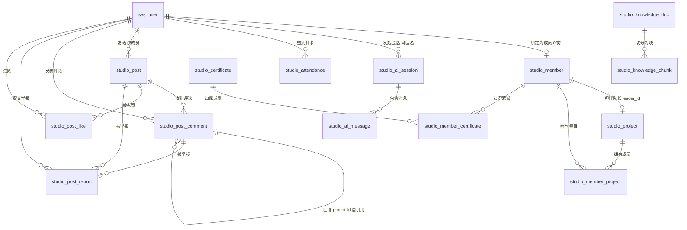
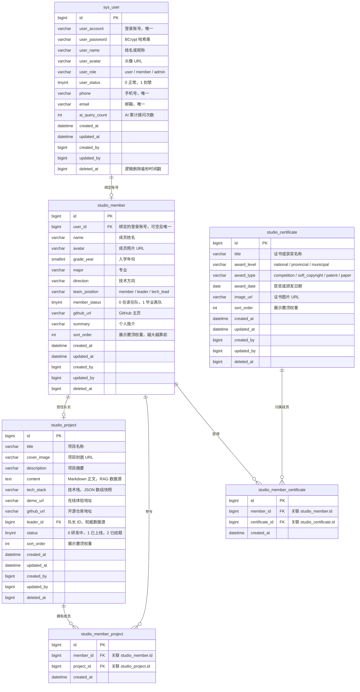
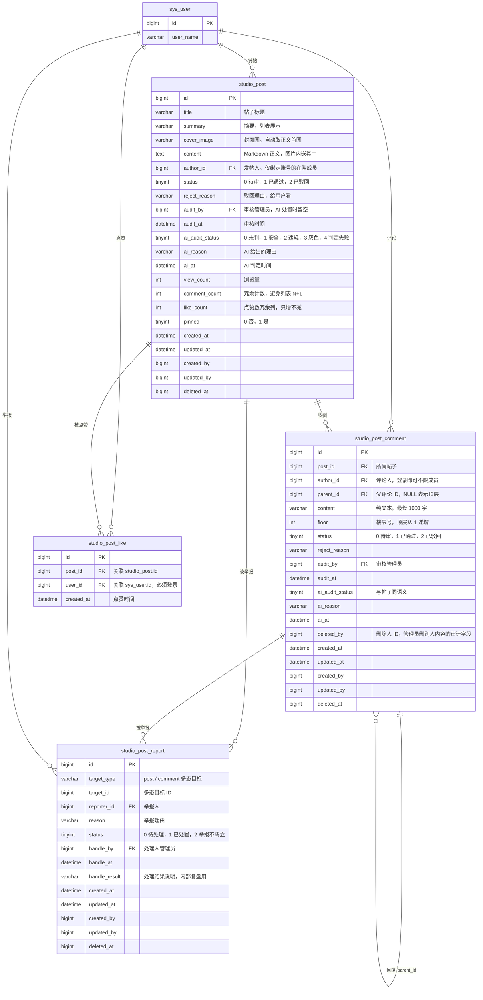
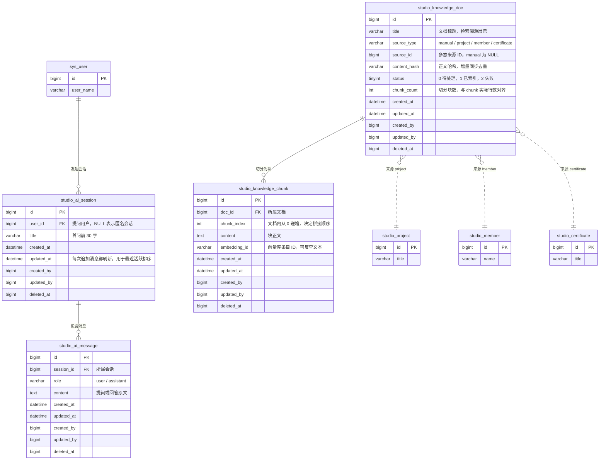
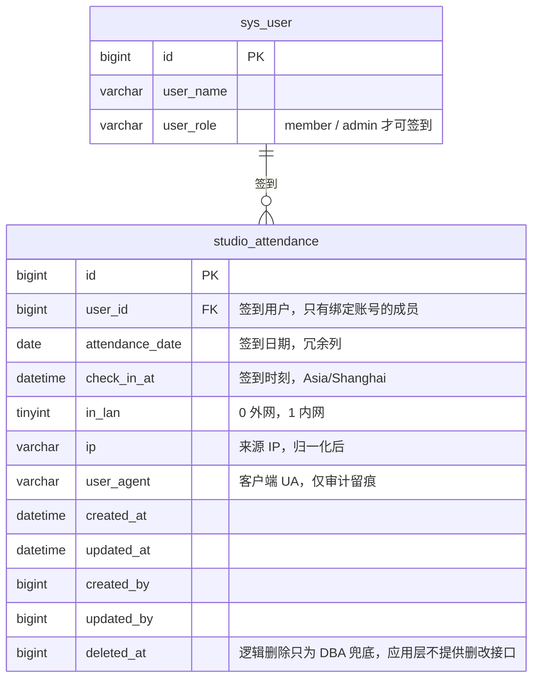
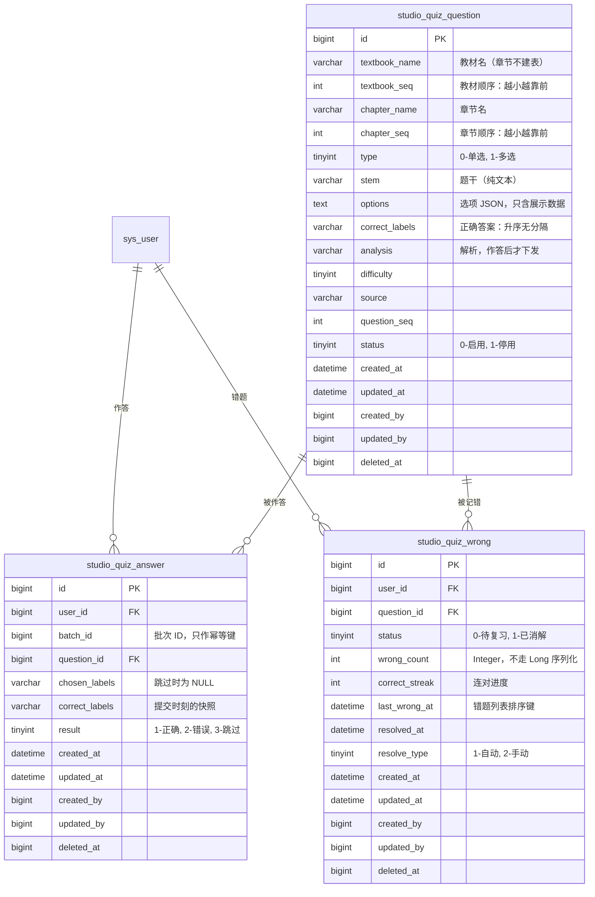
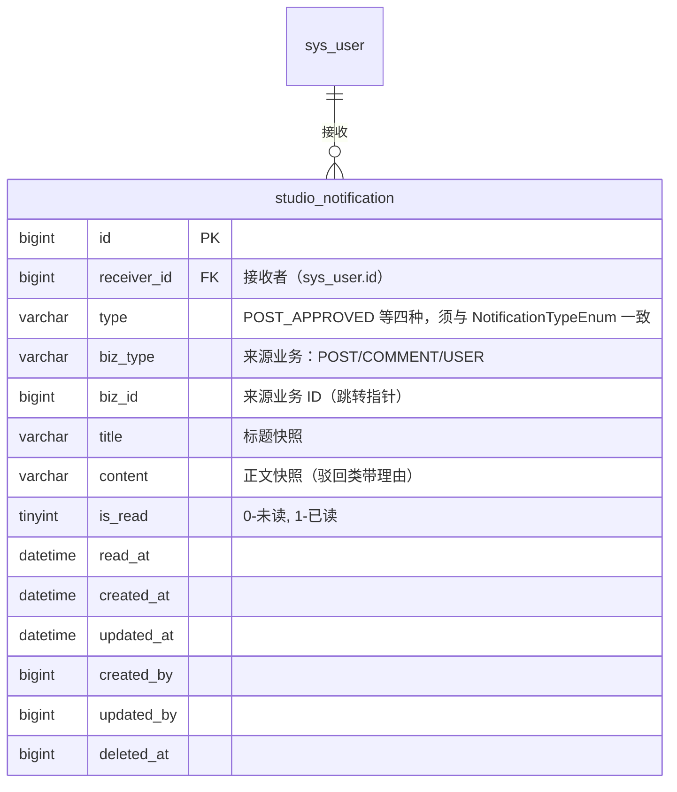
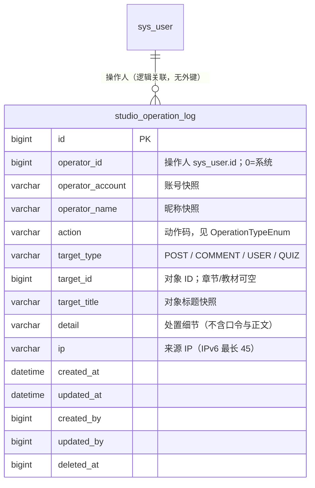

# 润石工作室 · 数据库 ER 图（重点模块）

> 覆盖 `studio_db` 全部 19 张表，重点展开 5 个核心业务域。
> DDL 源头：`db/user.sql`（唯一权威，从零初始化的全量脚本，含全部 19 张表）。
> 原先 `db/migration/` 下的增量迁移脚本已合并进该文件并删除。

## 阅读约定（先看这里，否则图会看反）

| 约定 | 说明 |
|---|---|
| **主键统一雪花 ID** | 所有表都用 `bigint id`，由 MyBatis-Plus `ASSIGN_ID` 生成，**非自增**。好处是分库分表 / 提前生成 ID 不用回查 |
| **逻辑删除 `deleted_at`** | `bigint` 毫秒时间戳，`0` = 未删除。因此所有**唯一键都带 `deleted_at`**（如 `uk_account_deleted`），保证「删掉还能重建同名数据」 |
| **审计四列** | `created_at / updated_at / created_by / updated_by`，由 `MetaObjectHandler` 自动填充，业务代码不手写 |
| **没有数据库外键** | 全部 14 张表的 DDL 里**一条 `FOREIGN KEY` 都没有**——关联由应用层（MyBatis-Plus）维护。下图连线只表示「逻辑关联」，标注了 `FK` 的列指向对应表的 `id` |
| **两张关联表是物理删除** | `studio_member_project` / `studio_member_certificate` 没有 `deleted_at`：关系解除即无业务意义，不需要追溯 |
| **多态关联** | 举报表、知识库文档表用 `xxx_type + xxx_id` 两列指向不同表，图中用**虚线**表示（数据库层无约束） |
| **图例** | `PK` 主键、`FK` 逻辑外键、`UK` 唯一键（含在索引里，见下） |

---

## 一、全局 ER 总览

**四个域的划分**：用户与成员域（用户/成员/项目/证书及其关联）、社区内容域（帖子/评论/举报）、
AI 与 RAG 域（会话/消息/知识库）、考勤域。

第五个域是**刷题域**（题目 / 作答 / 错题本），见 2.5 节——它只有 3 张表，但设计取舍最多。

---

## 二、分模块详细 ER

### 2.1 用户与成员域

**索引要点**

| 表 | 唯一键 | 关键索引 |
|---|---|---|
| `sys_user` | `uk_account_deleted(account, deleted_at)`、`uk_phone_deleted`、`uk_email_deleted` | 账号/手机/邮箱都可为空，唯一键必须带 `deleted_at` |
| `studio_member` | `uk_userid_deleted(user_id, deleted_at)` | `idx_grade_status(grade_year, member_status, sort_order)`、`idx_direction` |
| `studio_project` | — | `idx_status_sort_time(status, sort_order DESC, created_at DESC)`、`idx_leader` |
| `studio_certificate` | — | `idx_type_date(award_type, award_date DESC)`、`idx_level_date` |
| `studio_member_project` | `uk_member_proj(member_id, project_id)` | `idx_proj_member` 反查「某项目的成员」 |
| `studio_member_certificate` | `uk_member_cert(member_id, certificate_id)` | `idx_cert_member` 反查「某证书的成员」 |

---

### 2.2 社区内容域（帖子 / 评论 / 举报）

**索引要点**

| 表 | 唯一键 | 关键索引 |
|---|---|---|
| `studio_post` | — | `idx_status_pinned_time(status, pinned, created_at)`（C 端列表）、`idx_status_time(status, created_at)`（审核队列，**不能复用上一条**：第二列是 `pinned`，优化器跳不过中间列）、`idx_author_time(author_id, created_at)`（我的发帖） |
| `studio_post_comment` | — | `idx_post_status_id(post_id, status, id)`（详情页最高频；第三列放 `id` 让排序直接走索引顺序）、`idx_status_time`、`idx_author_time` |
| `studio_post_report` | `uk_target_reporter(target_type, target_id, reporter_id, deleted_at)` | `idx_status_time` |
| `studio_post_like` | `uk_post_user(post_id, user_id)`（一人一赞的根基） | `idx_user_created(user_id, created_at)` |

---

### 2.3 AI 咨询与 RAG 知识库域

**索引要点**

| 表 | 关键索引 |
|---|---|
| `studio_ai_session` | `idx_user_updated(user_id, updated_at DESC)`——「我的会话」按最近活跃倒序 |
| `studio_ai_message` | `idx_session_created(session_id, created_at)`；**排序必须带 `id`**：`created_at` 是秒级精度，同一秒的 user/assistant 会并列导致对话偶发颠倒 |
| `studio_knowledge_doc` | `idx_source(source_type, source_id)`；**刻意不为 `status` 建索引**——只有 3 个取值、选择性极差，而扫待处理文档是后台批量任务，全表扫描更快 |
| `studio_knowledge_chunk` | `uk_doc_chunk(doc_id, chunk_index, deleted_at)`（唯一键带 `deleted_at`，否则重建索引第二次会撞重复）、`idx_embedding` |

---

### 2.4 考勤域

**索引要点**

| 索引 | 用途 |
|---|---|
| `idx_user_time(user_id, check_in_at)` | 「我的签到历史」按月统计 |
| `idx_date_lan_time(attendance_date, in_lan, check_in_at)` | 「今日出勤看板」按天查 + 区分内外网 |

---

## 三、关键设计取舍（为什么这样建模）

1. **成员档案与登录账号分离**：`studio_member.user_id` 可空且唯一（`uk_userid_deleted`）。
   账号（`sys_user`）管登录与角色，档案（`studio_member`）管姓名/届别/方向等业务信息。
   二者不是一对一同步的——可以有账号没档案（普通注册用户），也可以有档案没账号（历史导入）。
   「能否发帖/打卡/无限用 AI」一律以档案为准，而不是角色标签。

2. **项目队长是权威源**：`studio_project.leader_id` 直接指向 `studio_member.id`，
   而不是只靠关联表推出来。后端保证「队长必然在参与成员列表里」（建/改项目时同步写关联表），
   因此前端可以直接渲染队长，不必先查关联再判断。

3. **帖子图片不建关联表**：正文是「CSDN 式」Markdown，图片以 `` 内嵌在 `content` 里，
   图片在第几段之后由 Markdown 自身决定，`post_id + url + sort_order` 表达不了。
   列表缩略图单独用 `cover_image` 存（入库时自动取正文首图，可覆盖）。

4. **评论只做两层楼中楼**：`parent_id` 自引用，`NULL` 表示顶层。
   读取时一次查完整个帖子的评论、在内存挂树，所以**不为 `parent_id` 建索引**——它只参与内存分组，不进 `WHERE`。
   `floor` 只在顶层评论递增，回复为 `NULL`。

5. **举报用多态**：`target_type + target_id` 指向帖子或评论。
   没有拆成两张举报表：举报字段完全一致，拆开只会让「举报列表」这类查询要 UNION。
   唯一键带 `deleted_at`：撤销举报后允许再次举报同一内容。

6. **RAG 的向量不在库里**：`studio_knowledge_doc` 只存「这份文档是什么、来自哪、切了几块」，
   `studio_knowledge_chunk.embedding_id` 只是向量库条目的**标识**，向量本体在
   LangChain4j 的 `EmbeddingStore`（本期内存实现）。这样替换向量库不用动表结构。
   `source_type + source_id` 让检索命中后能反查「答案是依据哪条业务数据生成的」。

7. **冗余列，且都在注释里写了理由**：
   - `studio_post.comment_count`：列表页要显示评论数，现算就是每帖一次 COUNT（一页 20 帖 = 20 次查询）；
   - `studio_attendance.attendance_date`：写成 `DATE(check_in_at)` 会让索引失效，派生后单独存一列才能走 `idx_date_lan_time`。

8. **AI 审核三列而非只靠 `status`**：`ai_audit_status / ai_reason / ai_at`。
   ① 异步任务要能识别「哪些还没判过」以保证幂等，否则重复送审会覆盖已有结论；
   ② 「还没轮到」（0）与「AI 判不了」（4）是两回事，混在一起管理端就感知不到 AI 故障。
   `audit_by` 在 AI 自动处置时**留空**——AI 不是人，不伪造管理员 ID。

9. **逻辑删除 + 唯一键必须带 `deleted_at`**：这是本项目贯穿全部表的约定。
   少了这一列，删除后的账号名/手机号/绑定关系会被唯一键永久占用，无法重建。

10. **点赞只能赞、不能取消**：`studio_post_like` 是与 `studio_member_project` 同类的**物理删除关系表**
    （无 `deleted_at`、无审计列），因为不存在「解除点赞」的场景，留逻辑删除位只会让唯一键和
    所有查询都多带一个条件。唯一键 `uk_post_user(post_id, user_id)` 是「一人一赞」的根基：
    应用层先查重，该唯一键兜住并发下的重复插入（两个请求同时通过查重时，第二个撞键）。
    计数走冗余列 `like_count`，用 `SET like_count = like_count + 1` 原子自增——与 `comment_count`
    同类，但只增不减，维护成本更低。`liked` 字段带「当前用户」语义，因此详情/列表响应不可被整体缓存。

---

### 2.5 刷题域（题目 / 作答 / 错题本）

**索引要点**

| 表 | 唯一键 | 关键索引 |
|---|---|---|
| `studio_quiz_question` | — | `idx_scope(textbook_name, chapter_name, status, question_seq, id)`：抽题、章节树、章节题数都走它；最后一列放 `id` 让「同题序」的行次序稳定 |
| `studio_quiz_answer` | `uk_user_batch_question(user_id, batch_id, question_id, deleted_at)` | `idx_user_result(user_id, result, id)` 概览统计、`idx_question_result(question_id, result)` 错误率榜 |
| `studio_quiz_wrong` | `uk_user_question(user_id, question_id, deleted_at)` | `idx_user_status_time(user_id, status, last_wrong_at)` 错题列表（最久没复习的先来） |

**四组设计取舍**（这是本域最值得读的部分）：

1. **选项存 JSON，不建选项表**：选项没有独立生命周期，改题就是整批重写；从属数据单独建表
   只会多一个 Mapper、一套级联删除、一次 N+1。代价是「改选项」必须整批写——但那本来就是正确做法。

2. **`options` 只存展示数据，正确性单独放 `correct_labels`**：这是本域最重要的一个决定。
   如果把「哪个是对的」放进选项 JSON，那么每次下发选项都得记得过滤，漏一次就是答案泄露。
   拆成两列之后，C 端 VO 可以把 `options` **原样下发**——脱敏靠数据结构，不靠记忆。
   同一思路的落地检查写在 `QuizDdlVerifyTest` 里（断言两列都存在）。

3. **章节不建表**：教材名 / 章节名就是题目上的四个列（两个名字 + 两个顺序）。
   章节只因题目存在而存在，空章节没有业务意义；「新增章节」就是往该章新增一道题。
   代价是改名 / 移章是批量 `UPDATE`——但那本来就该是原子的批量操作。
   ⚠️ 三个 `*_seq` 的语义与全站 `sort_order` **相反**（越小越靠前），同名会踩雷，故另起名。

4. **错题本是唯一有状态的表，且必须存在**：`correct_streak`（连对进度）、手动消解、
   「消解后再错要重开」都是**状态**，从作答记录派生不出来；用窗口函数现算会让每次查错题本都重算一遍。
   与它相对的是**会话表被刻意省掉**：题目不含答案，整批交给前端持有即可，
   服务端只需要 `batch_id` 做幂等。代价是换设备不能续答——刷题不是考试，重开成本为 0。

**停用 vs 删除的分工**（管理端最需要理解的一对概念）：

| | 停用（`status=1`） | 删除（逻辑删除） |
|---|---|---|
| 还能被抽到 | 否 | 否 |
| 错题本里还能看到 | **不能**（查询侧 `inSql` 过滤，条目保留） | 不能 |
| 可以恢复 | **是**（重新启用，条目自动回来） | 否 |
| 错题条目 | **不动** | **同事务清理** |
| 历史作答 | 不动 | 不动（统计只读 `result`） |

停用时不动条目、靠查询过滤，是为了让「下线」可逆——否则管理员误停一次，
用户的错题记录就永久消失了。而删除是不可逆的，所以条目要一并清理（题目没了，条目无处可去）。

**判定相关变更的副作用**：改正确答案、改题型、增删选项（label 集合变化）会让该题
**所有用户**的 `correct_streak` 归零，但 **`status` 保持不变**——已消解的题不退回待复习
（用户曾经掌握过这件事仍然成立）。只改选项**文字**不算判定相关变更：
「你当时选了 C」仍然指向同一个选项，历史记录的可解释性没被破坏。

---

### 2.6 通知域（站内通知）

1. **`title`/`content` 是快照，不是模板引用**：通知发出后，业务数据怎么变
   （帖子改名、评论被删、成员身份被收回）都不影响已收到通知的文字。
   存模板 ID 现拼意味着每次展示都要重新理解一遍当时的上下文——那是用复杂度换不存在的好处。

2. **`uk_receiver_biz(receiver_id, type, biz_type, biz_id, deleted_at)` 一身二职**：
   既是唯一键铁律的落地，又是**幂等**的数据库层保证——同一事件重复投递
   （审核接口被重放、消息队列重试）撞键即视为已投递，与 `uk_post_user` 同一套路。
   应用层的状态守卫（审核只处理待审帖）是第一道，唯一键是第二道。

3. **同步投递，不用事件总线**：触发点（审核结论、评论回复、身份授予）都在
   **同一业务事务**里调 `notify`——通知与主业务同生共死，不会出现
   「帖子通过了、通知却没发」。反过来若用 `REQUIRES_NEW` 独立事务，
   主业务回滚后通知已发出，用户会看到一条指向不存在结果的通知。
   唯一键冲突时 MySQL 只让该语句失败、不损坏事务，catch 后事务照常可用。

4. **`biz_type`/`biz_id` 允许悬空**：来源被删后指针指向不存在的数据，
   前端按「内容已失效」降级展示即可——通知本身的价值（你被回复过）不因此消失。
   为此**不加外键**（本项目全部表都没有外键，级联删除会带来更多意外）。

5. **未读计数不缓存**：`idx_receiver_read` 覆盖 `COUNT(*)`，60s 一轮的铃铛轮询
   在这个量级下让数据库毫无感知（与「不加二级缓存」是同一条判断线）。

---

### 2.7 审计域（管理端操作日志）

1. **账号、昵称、标题都是快照**：审计要回答的是「当时发生了什么」。
   账号被删、帖子被删之后，关联查询只会得到空值；快照让这条记录始终可读。
   只存 ID 的方案在数据完好时更好看，但审计恰恰是在数据出问题之后才被翻出来。

2. **动作码 + 对象类型分离**：`action` 说明「做了什么」（`POST_REJECT`），
   `target_type` 说明「对哪类对象」。合成一列会让「筛出所有用户相关操作」退化成
   前端维护一份动作码 → 类型的映射，而后端新增动作时代码不会报错，只会静默认不出来。

3. **埋点在 Service 而不是切面**：切面只能拿到方法签名，拿不到「实际影响了哪几行、
   驳回理由是什么、角色从什么改成了什么」。这些恰恰是事故排查时唯一有用的信息。
   代价是要在每处写操作后显式调用一次 `OperationLogService#record`，换来的是语义准确。

4. **日志与业务写在同一事务里**：`record` 不加 `@Transactional`，自动加入调用方事务。
   业务回滚则日志一起消失——不会留下一条「操作成功」的假痕迹。
   反过来，日志写入失败只打一条 `warn` 并吞掉异常：日志表满不能让审核失败。

5. **一篇内容一行**：批量审核 20 篇就是 20 行（一次 `saveBatch` 落库）。
   事故排查的入口通常是「这篇帖子被谁驳回了」，按 `target_id` 反查才有结果；
   合并成一行的话，`idx_target` 失效，只能退化成对 `detail` 全文搜索。
   章节 / 教材 / 批量导入这类没有单一对象的动作，`target_id` 为 null，靠标题快照定位。

6. **索引围绕两类访问**：默认视图是 `created_at DESC, id DESC`（`idx_created`，id 解决同秒排序），
   反查是「操作人 / 动作 / 对象」三个维度各一条复合索引。
   日志只增不减，没有更新路径，因此不需要为写放大做任何妥协。
