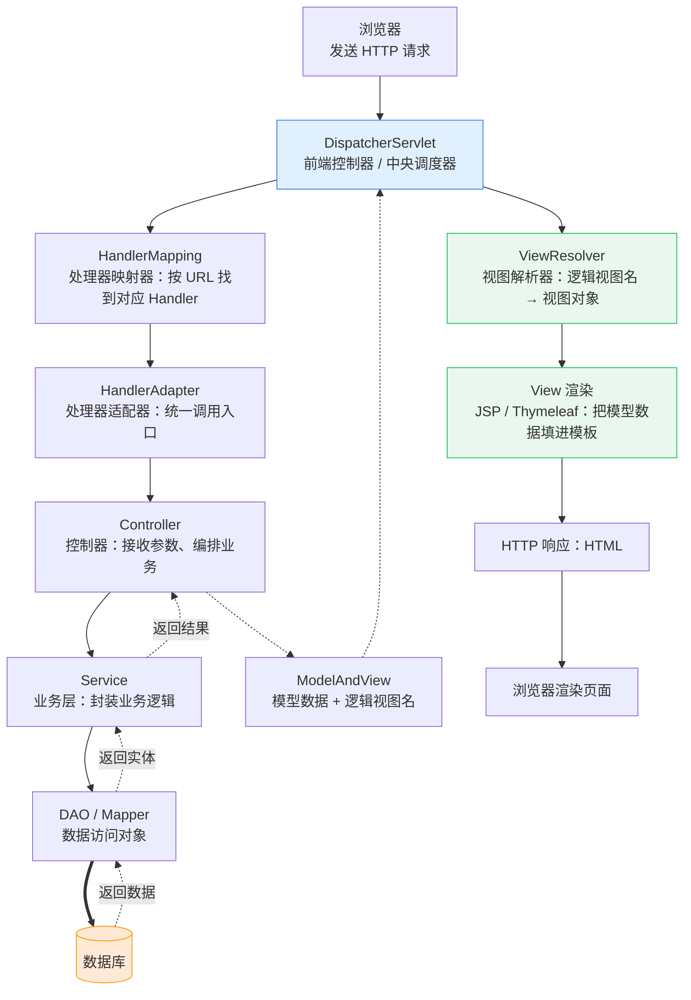
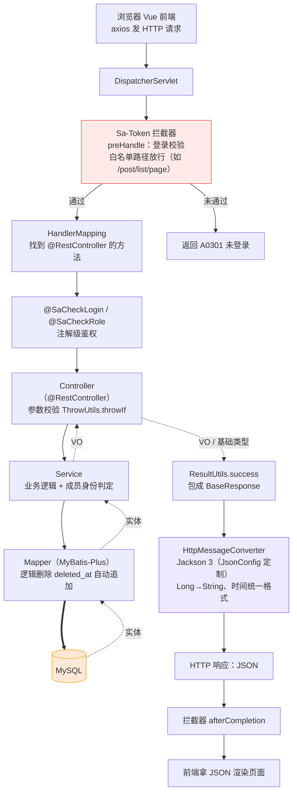

# Spring MVC 请求处理流程

## 一、传统 Spring MVC 全链路（服务端渲染）

这是教科书上的完整链路：**服务端把数据塞进页面再返回**，因此终点是经过 ViewResolver 解析、View 渲染出的 HTML。

### 各组件一句话职责

| 组件 | 干什么 | 为什么需要它 |
|---|---|---|
| `DispatcherServlet` | 接收所有请求，统一调度 | 没有它，每个 URL 都要一个 Servlet |
| `HandlerMapping` | 按 URL 找到对应的 Controller 方法 | 把「URL → 方法」的映射关系从代码里抽出来 |
| `HandlerAdapter` | 统一调用各种 Handler | Handler 有多种形态（注解式、实现接口式、Servlet），适配器让 DispatcherServlet 不必关心差异 |
| `Controller` | 接参数、调 Service、决定返回什么 | 业务编排层 |
| `Service` | 封装业务逻辑与事务边界 | 业务逻辑不写在 Controller 里，才能被复用 |
| `DAO / Mapper` | 与数据库交互 | 隔离 SQL 与业务代码 |
| `ModelAndView` | 装「数据」+「用哪个页面渲染」 | 服务端渲染需要同时知道这两件事 |
| `ViewResolver` | 逻辑视图名 → 真实视图对象 | 让 Controller 只写 `"user/list"`，不关心页面在磁盘哪儿 |
| `View` | 把模型数据渲染成 HTML | 模板引擎干活的地方 |

---

## 二、本项目实际走的链路（前后端分离，无视图渲染）

本项目是 `@RestController` + 独立前端（`web/`），因此 **ViewResolver、View、ModelAndView 三个环节都不存在**。
取而代之的是：返回值直接交给 `HttpMessageConverter` 序列化成 JSON。

### 两个流程的关键差异

| 环节 | 传统链路 | 本项目 |
|---|---|---|
| Controller 注解 | `@Controller` | `@RestController`（= `@Controller` + `@ResponseBody`） |
| 返回值 | `ModelAndView` / 视图名 | VO 或直接是基础类型 |
| 页面由谁渲染 | **服务端**（JSP / Thymeleaf） | **浏览器**（Vue 拿 JSON 渲染） |
| ViewResolver / View | 必需 | **完全不存在** |
| 序列化环节 | 无（直接产出 HTML） | `HttpMessageConverter` → JSON（本项目用 Boot 4 内置的 Jackson 3，由 `JsonConfig` 统一改了 Long 与时间的序列化方式） |
| 鉴权位置 | 通常在拦截器里手写 | Sa-Token 拦截器（全局）+ 注解（`@SaCheckLogin` / `@SaCheckRole`）双层 |

> 顺带一提：本项目的 `DeletedAtTypeHandler`、MyBatis-Plus 的 `@TableLogic` 都在 Mapper 那一层自动生效，
> 业务代码里看不到 `deleted_at = 0` 这个条件。
